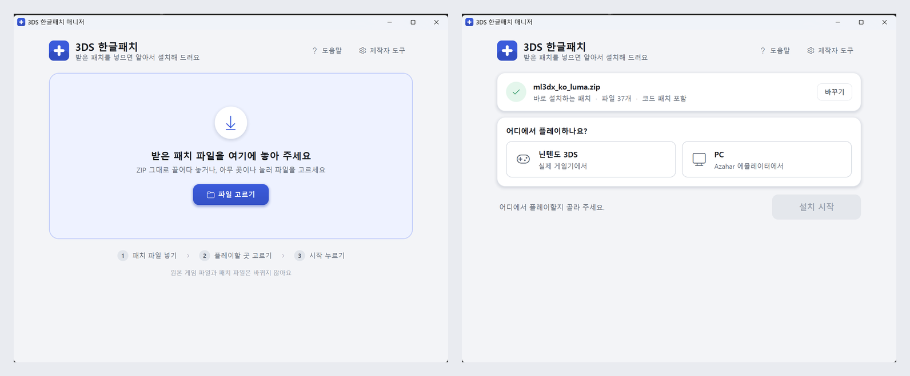

# 3DS Korean Patch Manager / 3DS 한글패치 매니저

3DS 번역 패치의 제작과 적용을 돕는 도구입니다. 파일별 패치, Luma3DS·Azahar용 패키지, 업데이트와 번역·HOME 배너를 합친 게임 파일 만들기를 지원합니다. 처음 쓰는 사람을 위해 한국어 안내와 도움말을 제공합니다.

This tool helps creators and players prepare and apply 3DS translation patches. It supports file-level patches, Luma3DS and Azahar packages, and rebuilding a game with an update, translation and optional HOME banner. The interface and built-in help are currently in Korean.

처음 화면은 **초간단 모드**입니다. 받은 패치 ZIP을 창에 끌어다 놓고, 플레이할 곳(닌텐도 3DS 또는 PC)을 고른 뒤 시작을 누르면 됩니다. 패치 종류는 프로그램이 알아내며, 설치용 ZIP은 SD 카드나 에뮬레이터 폴더에 바로 넣고, 게임 파일이 필요한 패치는 본인의 게임 파일을 하나 더 받아 처리합니다. 이미 다른 패치가 들어 있으면 먼저 물어본 뒤 기존 폴더를 백업 폴더로 옮깁니다. 패치를 직접 만드는 기능은 오른쪽 위 「제작자 도구」(간편 모드·전체 모드)에 있습니다.

The first screen is **Easy mode**: drop the patch ZIP you received onto the window, choose where you play (Nintendo 3DS or PC) and press start. The tool works out the patch type itself. A ready-to-install ZIP is copied to the SD card or the emulator folder; a patch that needs the game asks for your own game file. If another patch is already installed, the tool asks first and moves the existing folder to a backup folder. Authoring features remain under "제작자 도구" (Simple and Full modes) at the top right.

0.4.0부터는 **레시피 패치**(내 게임 파일로 만드는 패치)도 받습니다. 게임 데이터가 없는 작은 ZIP과 본인의 게임 파일(본편·업데이트, 선택으로 DLC)을 함께 넣으면, 게임별 엔진이 이 PC에서 패치를 만들어 SD 카드·에뮬레이터에 설치하거나 본편+업데이트(+DLC)+패치를 합친 게임 파일(PC `.3ds`, 3DS `.cia`)을 만듭니다. 패치 코드가 Luma3DS의 LayeredFS 코드 자리와 겹치면 설치하지 않습니다. 첫 엔진은 대난투 스매시브라더스 for Nintendo 3DS 한국판입니다.

Since 0.4.0 the tool also takes **recipe patches**: a small ZIP without game data plus your own game files (base, update, optionally DLC). A per-game engine builds the patch on your PC and either installs it to the SD card or emulator, or builds one all-in-one game file (PC `.3ds`, 3DS `.cia`). Code patches that would collide with Luma3DS's LayeredFS code are refused. The first engine is for the Korean Super Smash Bros. for Nintendo 3DS.

## 시작하기 / Getting started

Windows 64비트 배포판은 [Releases](https://github.com/auseong325-design/3ds-patch-universal-tool/releases)에서 ZIP을 받아 압축을 푼 뒤 실행하세요. Python과 .NET은 배포판에 포함되어 있습니다.

For the Windows x64 portable build, download and extract the ZIP from [Releases](https://github.com/auseong325-design/3ds-patch-universal-tool/releases). Python and .NET are included.

Windows: Python 3.10+와 Tkinter를 설치하고 `upstream/TranslationToolkit/3DS 한글패치 매니저 실행.bat`를 실행하세요. 리팩에는 .NET 10과 RomForge 브리지가, xdelta 패키지에는 xdelta3가 필요합니다. [상세 안내](upstream/TranslationToolkit/README_KO.md)

On Windows, install Python 3.10+ with Tkinter and run `upstream/TranslationToolkit/3DS 한글패치 매니저 실행.bat`. Repacking requires .NET 10 and the RomForge bridge; xdelta packages require xdelta3. See the [Korean guide](upstream/TranslationToolkit/README_KO.md) and [bridge build notes](RomForge-reference/README_KPM.md). A Windows portable build can be created using `packaging/build_portable.py`.

게임 파일, 번역 패치, 암호화 키와 인증서는 포함하지 않습니다. 일부 기능은 입력과 출력에 따라 키가 필요합니다. 실제 기기에서의 실행은 별도로 확인해야 합니다.

Game files, translation patches, encryption keys and certificates are not included. Some operations require user-provided keys. Successful rebuilding does not guarantee that a game will run on hardware.

## 출처와 감사 / Credits and thanks

이 프로젝트는 [Translation Toolkit](https://github.com/Ich73/TranslationToolkit)의 로컬 포크와 [RomForge](https://github.com/sinjunyoung/RomForge)의 로컬 포크를 바탕으로, 제작부터 사용자 적용까지 한 흐름으로 돕기 위해 만들었습니다. 기존 도구를 공개해 주신 제작자와 기여자분들께 깊이 감사드리며, 그 노력을 존중합니다. 번역 보조 코드에는 [BinJEditor](https://github.com/Ich73/BinJEditor)의 JTools가 포함됩니다.

This project builds on local forks of [Translation Toolkit](https://github.com/Ich73/TranslationToolkit) and [RomForge](https://github.com/sinjunyoung/RomForge), bringing patch creation and application into one workflow. We sincerely thank the original authors and contributors for sharing their work and respect the effort behind it. It also includes JTools from [BinJEditor](https://github.com/Ich73/BinJEditor).

## 라이선스 / Licenses

Translation Toolkit 및 JTools는 GPL-3.0, RomForge는 GPL-2.0-or-later입니다. 배포판에 들어 있는 [3dstool](https://github.com/dnasdw/3dstool) 1.2.6은 MIT입니다. 각 폴더의 라이선스와 제3자 구성요소 고지를 확인하세요. 배포용 런타임은 별도로 해당 라이선스를 동봉합니다.

Translation Toolkit and JTools are GPL-3.0; RomForge is GPL-2.0-or-later. The portable build includes [3dstool](https://github.com/dnasdw/3dstool) 1.2.6 (MIT). See the individual license files and third-party notices for the relevant components.
